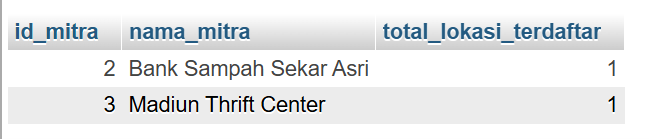
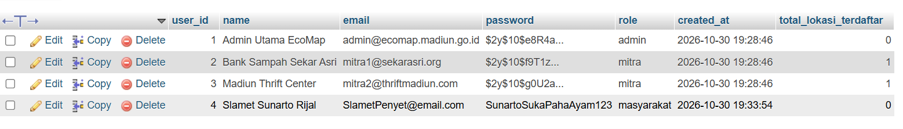
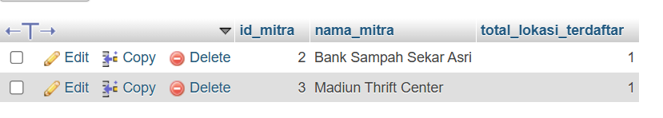

**1. Eksplorasi JOIN (Tahap 1): Tulis dan eksekusi satu query yang menggunakan JOIN (minimal 2 tabel) dikombinasikan dengan fungsi agregasi (misal: menghitung total transaksi per pelanggan atau total barang terjual). Catat kompleksitas query-nya.**

Jawab : 
```sql
 -- 1.Menghitung total tempat/lokasi ramah lingkungan yang didaftarkan oleh setiap mitra
SELECT 
    u.user_id AS id_mitra,
    u.name AS nama_mitra,
    COUNT(l.lokasi_id) AS total_lokasi_terdaftar
FROM users u
JOIN lokasi l ON u.user_id = l.mitra_id
WHERE u.role = 'mitra'
GROUP BY u.user_id, u.name;
```



 Analisis Kompleksitas Query:

Kompleksitas Waktu (Time Complexity): Secara teoretis, kompleksitas kueri ini berada pada kisaran O(N×M) atau O(N log⁡ N ) jika dioptimalkan dengan indeks.

-Mesin database harus melakukan pemindaian atau pencocokan baris (join) antara tabel users (N baris) dan tabel lokasi (M baris) melalui kolom relasi foreign key (mitra_id).
-Proses filter WHERE u.role = 'mitra' membantu mempersempit baris awal dari tabel users sebelum dicocokkan.
-Fungsi agregasi COUNT() dan pengelompokan GROUP BY memerlukan tahapan tambahan berupa penyortiran atau pengelompokan data akhir berdasarkan ID mitra.

Kompleksitas Ruang (Space Complexity):O(K), di mana K adalah jumlah baris unik mitra yang lolos dari filter dan berhasil dikelompokkan pada tabel hasil sementara (temporary result set).

**2. Penerapan Denormalisasi (Tahap 2): Eksekusi DDL (ALTER TABLE atau CREATE TABLE) untuk menambahkan satu atribut turunan pada tabel master ATAU membuat satu tabel rekapitulasi yang menyimpan hasil dari perhitungan tahap 1.** 

**[CONTOH ILUSTRASI, uji dulu di versi yang dipakai]: ALTER TABLE pelanggan ADD COLUMN total_belanja DECIMAL(15,2) DEFAULT 0;**

Jawab : 

```sql
-- 2. A. Menambahkan atribut redundan (turunan) pada tabel master (users)
ALTER TABLE users 
ADD COLUMN total_lokasi_terdaftar INT DEFAULT 0;

-- B. Mengisi kolom turunan tersebut dengan data hasil agregasi dari tabel lokasi
UPDATE users u
SET total_lokasi_terdaftar = (
    SELECT COUNT(l.lokasi_id)
    FROM lokasi l
    WHERE l.mitra_id = u.user_id
);
```


**3. Pembuktian (Tahap 3): Tulis query SELECT sederhana untuk memanggil data dari kolom/tabel denormalisasi (Tahap 2) tanpa menggunakan JOIN atau agregasi. Bandingkan dengan query Tahap 1.**

Jawab : 

```sql
-- 3. Query baca yang sangat cepat untuk fitur dasbor tanpa JOIN atau agregasi
SELECT 
    user_id AS id_mitra,
    name AS nama_mitra,
    total_lokasi_terdaftar
FROM users
WHERE role = 'mitra';
```


Perbandingan Antara Tahap 1 dan Tahap 3 Dari Sisi Kompleksitas & Performa:
-Tahap 1 (Normalisasi Penuh): Menggunakan JOIN dan fungsi agregasi COUNT(). Proses kerjanya dinamis (on-the-fly), di mana MySQL harus mencocokkan baris antar tabel secara langsung setiap kali kueri dipanggil. Kompleksitas waktunya tinggi (O(N×M)), sehingga jika data pada tabel lokasi sudah mencapai ribuan baris, aplikasi akan terasa lambat (slow query) saat memuat halaman dasbor.
-Tahap 3 (Hasil Denormalisasi): Menggunakan kueri SELECT sederhana dari satu tabel saja tanpa JOIN dan tanpa fungsi agregasi. Nilai totalnya sudah tersedia secara fisik di dalam kolom total_lokasi_terdaftar. Kompleksitas waktunya menjadi jauh lebih cepat (O(N)), sangat optimal untuk mendukung performa pemuatan halaman dasbor (dashboard aplikasi). 
